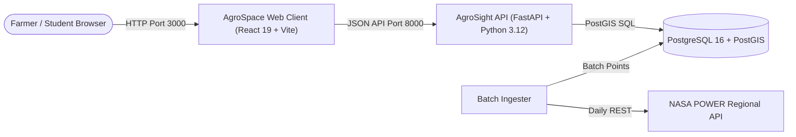

# AgroCyberSpace — AgroSight & AgroSpace

> **NASA Space Apps Challenge Platform**  
> Empowering smallholder farmers and agricultural communities in Mozambique through satellite Earth Observation data, participatory science, and interactive storytelling.

---

## 1. Overview

**AgroCyberSpace** is a comprehensive educational agriculture platform combining:
- **AgroSight API (`apps/backend`):** A high-performance Python 3.12 / FastAPI geospatial backend delivering NASA POWER meteorological reanalysis, CENACARTA administrative boundaries, national crop statistics (INE/MADER CAP 2023/2024), and national pedological soil maps (INIA 1995) powered by PostgreSQL and PostGIS.
- **AgroSpace Web Client (`apps/frontend/web`):** A story-driven, accessible React 19 / TypeScript web application inspired by *Saving Satoshi*, delivering 12 pedagogical chapters, interactive farming challenges, and multi-accent voice narration (Portuguese and English).
- **Study Regions:** Tailored agricultural contexts across three Mozambican provinces: **Gaza** (Limpopo Basin), **Zambézia** (Licungo Basin), and **Tete** (Angónia & Zambezi Basin).

---

## 2. System Architecture



---

## 3. Repository Structure

```
.
├── apps/
│   ├── backend/            # FastAPI backend, PostGIS models, Alembic migrations, test suite
│   └── frontend/
│       └── web/            # Vite + React 19 web application, speech audio, challenges engine
├── docs/                   # Centralized documentation:
│   ├── README.md           # Documentation index and hub
│   ├── architecture.md     # Deep-dive system architecture & data flow
│   ├── docker.md           # Docker container specs, Compose stacks, and deployment
│   ├── api.md              # REST API reference and endpoint documentation
│   ├── development.md      # Local setup guide, database seeding, and testing
│   └── conventional-commits.md # Conventional Commits specification and guidelines
├── infra/                  # Infrastructure and container configurations:
│   ├── docker/             # Dockerfiles (backend, frontend)
│   ├── docker-compose.yml  # Production container stack
│   └── docker-compose.dev.yml # Development container stack with hot-reload
├── .github/
│   └── workflows/          # GitHub Actions CI/CD and commit linting workflows
├── .dockerignore           # Container build exclusions
├── .gitignore              # Git exclusions
├── .env.example            # Master environment variable template
└── README.md               # Main project landing page
```

---

## 4. Quickstart

### Prerequisites
- Python 3.12 (managed via [`uv`](https://docs.astral.sh/uv/))
- Node.js >= 20.x and npm
- PostgreSQL with PostGIS extension (or free cloud instance on Neon/Supabase)
- Docker & Docker Compose (optional for containerized execution)

---

### 4.1 Running with Docker Compose (Recommended)

1. Copy the environment configuration:
   ```bash
   cp infra/.env.example infra/.env
   ```
2. Configure `DATABASE_URL` and `JWT_SECRET` in `infra/.env`.
3. Launch the container stack:
   ```bash
   docker compose --env-file infra/.env -f infra/docker-compose.yml up --build -d
   ```
4. Access the services:
   - **AgroSpace Web App:** `http://localhost:3000`
   - **Interactive API Swagger UI:** `http://localhost:8000/api/v1/docs`
   - **Health Check:** `http://localhost:8000/health`

---

### 4.2 Running Locally from Source

#### Backend (`apps/backend`):
```bash
cd apps/backend
cp .env.example .env
uv sync
uv run python scripts/check_env.py
uv run alembic upgrade head
uv run python scripts/seed.py
uv run fastapi dev app/main.py --port 8000
```

#### Frontend (`apps/frontend/web`):
```bash
cd apps/frontend/web
npm install
npm run dev
```

---

## 5. Documentation Hub

Detailed documentation is organized in the [`docs/`](docs/) directory:

- [**System Architecture**](docs/architecture.md) — Comprehensive technical architecture, geospatial pipelines, and offline resilience.
- [**Docker Containers & Deployment**](docs/docker.md) — Multi-stage Dockerfiles, Compose services, networking, and volumes.
- [**REST API Reference**](docs/api.md) — Endpoint specifications, request/response models, and error structures.
- [**Development & Contribution Guide**](docs/development.md) — Step-by-step setup, database migrations, tests, and code quality.
- [**Conventional Commits Specification**](docs/conventional-commits.md) — Git commit standards, scopes, and automated CI validation.

---

## 6. Code Quality & Standards

All contributions adhere to strict quality benchmarks:
- **Backend Quality:** Ruff (linting & formatting), Mypy (strict type checking), Pytest (unit & integration tests).
- **Frontend Quality:** TypeScript strict mode, Oxlint, Vite production bundle optimization.
- **Git Commits:** [Conventional Commits v1.0.0](docs/conventional-commits.md).

---

## 7. License

This project is licensed under the GNU General Public License v3.0 — see the [LICENSE](LICENSE) file for details.
