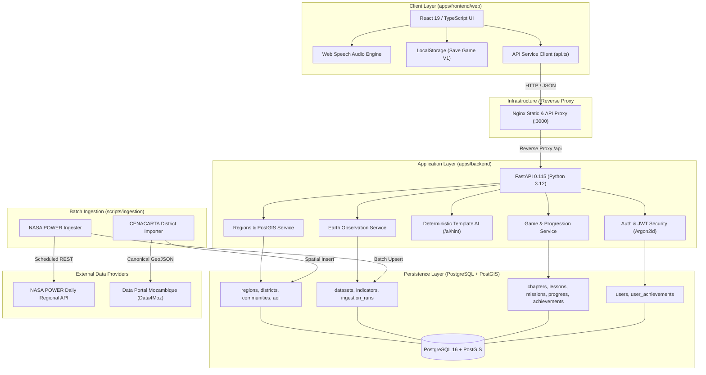

# System Architecture

## 1. High-Level Overview

**AgroSight / AgroSpace** is an educational space agriculture platform created for the NASA Space Apps Challenge. The system translates complex Earth Observation datasets into actionable, story-driven agricultural challenges for farmers, extension workers, and students in Mozambique.

The platform is designed around four core architectural principles:
1. **Scientific Grounding:** All agricultural challenges, crop rotations, and soil profiles are backed by official national datasets (CENACARTA 2017, INE/MADER CAP 2023/2024, INIA/IIAM 1995) and satellite reanalysis (NASA POWER).
2. **Offline Resilience:** Both the backend and web client operate reliably even under intermittent or absent network connectivity. Player state is synchronized with fallback to browser local storage.
3. **Strict Separation of Concerns:** Real-time player requests never trigger external calls to NASA servers. Earth Observation ingestion is an asynchronous, operator-controlled batch process.
4. **Deterministic Guidance:** Hints and explanations are generated deterministically using validated scientific templates without black-box generative hallucinations.

---

## 2. System Architecture Diagram

---

## 3. Frontend Architecture (`apps/frontend/web`)

The frontend is an accessible, touch-first Single Page Application built on **React 19** and **Vite**:

- **Presentation Engine:**
  - `ChaptersPage.tsx`: Displays the 12-chapter progression grid, study region selector chips, topbar branding, backend health pill, and language toggle.
  - `PlayPage.tsx`: Renders the stage illustration (`SceneArt`), synchronized speaker dialogues, Web Speech TTS playback, user replies, and embedded challenge mini-games.
  - `Challenges.tsx`: Implements interactive mini-game mechanics: multi-choice agronomic quizzes, rainfall zone splitters, soil texture matchers, NDVI map reading, and crop rotation builders.
- **Backend API Service (`services/api.ts`):**
  - Communicates with FastAPI endpoints with automatic timeout management (6s abort controller).
  - Handles `/health` checks, `/regions` retrieval, `/ai/hint` contextual explanations, and progress synchronization.
  - Degrades gracefully: if the backend is down or unreachable, the application continues in `Offline Mode` without blocking user progress.
- **Speech Synthesis Driver (`speech.ts`):**
  - Reads narration and dialogue aloud using browser-native speech synthesis with automated voice selection for Portuguese and English.

---

## 4. Backend Architecture (`apps/backend`)

The backend is built with **FastAPI** adhering to clean modular domain boundaries:

- **Core Layer (`app/core/`):**
  - `config.py`: Environment-driven settings with Pydantic Settings.
  - `database.py`: SQLAlchemy 2 engine with connection pooling and automated ping retries resilient to sleeping serverless databases (Neon, Supabase).
  - `security.py`: Argon2id password hashing and JWT access/refresh token signing.
- **Geospatial & Spatial Indexing (`app/modules/regions/`, `app/modules/agriculture/`):**
  - Uses `GeoAlchemy2` and native PostGIS geometry columns (`Geometry('POLYGON', srid=4326)`).
  - Employs GIST indexes for ultra-fast spatial intersection checks (`ST_Covers`, `ST_Intersects`).
  - Implements bounding box spatial config endpoints for frontend map viewers.
- **Earth Observation Module (`app/modules/earth_observation/`):**
  - Manages metadata catalogue (`datasets`), daily gridded timeseries observations (`indicators`), and ingestion run logs (`ingestion_runs`).
  - Spatial point-in-polygon filtering ensures only meteorological points within confirmed region AOIs are saved.
- **Deterministic AI Template Module (`app/modules/ai/`):**
  - Provides reliable agronomic explanations and hints based on verified datasets.
  - Disallows unvalidated fields and eliminates LLM hallucinations or external token costs.

---

## 5. Data Flow & Regional Adaptation

The platform tailors data to three primary Mozambican study areas:
1. **Gaza Province:** Focused on the Chókwè irrigation perimeter and Limpopo River basin (semi-arid, flood/drought cycles, rice and maize).
2. **Zambézia Province:** Focused on the Mocuba district and Licungo River basin (sub-humid, high seasonal rainfall, cassava, maize, legumes).
3. **Tete Province:** Focused on the Angónia plateau and Zambezi River basin (highland agro-ecology, fertile soils, potatoes, maize, beans).

When a player selects a region, the game context, AOI boundary, district crop statistics, and NASA POWER indicators adapt dynamically to reflect local realities.
